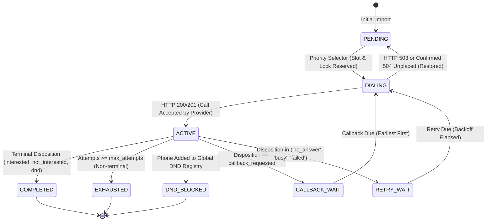

# Durable Campaign Dispatcher (Assignment B)

[](https://www.python.org/downloads/)
[]()
[]()
[]()

A fault-tolerant, event-driven campaign dispatcher designed to orchestrate outbound AI voice campaigns across multiple tenants and regulatory calling windows. Engineered to guarantee **at-most-once dialing**, handle network chaos (HTTP 503/504 errors, dropped webhooks, duplicate callbacks), and recover cleanly from abrupt process crashes (`kill -9`).

---

## 📌 Problem Overview & Rules

Outbound voice AI systems operate in hostile environments: telephony providers drop webhooks, rate limits trigger 503s, network partitions cause ambiguous 504 timeouts, and telecom regulations impose strict legal hours.

This engine implements the **9 Core Rules (R1–R9)** specified by the assignment:

* **R1 (Calling Windows):** Respects India regulatory calling hours (**09:00–21:00 IST**) combined with campaign-specific windows and allowed days of the week.
* **R2 (Tenant Concurrency):** Enforces strict maximum concurrent active calls per tenant across all its campaigns.
* **R3 (Single Phone Lock):** Prevents dialing the same phone number across multiple campaigns or tenants simultaneously.
* **R4 (Attempt Limits):** Caps contact attempts per lead at `max_attempts`.
* **R5 (Retry Backoff):** Schedules non-terminal retries dynamically:
  * `no_answer`: 60 minutes
  * `busy`: 60 minutes
  * `failed`: 15 minutes
* **R6 (Priority Scheduling Order):** Strict dispatch order:
  1. **Due Callbacks** (sorted by earliest `callback_at` to minimize lateness)
  2. **Due Retries** (sorted by earliest `next_retry_at`)
  3. **Fresh Leads** (sorted by original `row_order`)
* **R7 (Terminal Dispositions):** Leads marked `interested`, `not_interested`, or `dnd` immediately terminate and never retry.
* **R8 (Global DND Propagation):** Opting into DND immediately propagates globally across **all** tenants and campaigns.
* **R9 (State Precedence):** Deterministic final lead classification in `final_state.csv`:
  $$\text{completed} > \text{exhausted} > \text{dnd\_blocked}$$

---

## 🏗️ Architecture & Lead State Machine



### Core Components

1. **State Store (`solution/db.py`):**
   - SQLite in **Write-Ahead Logging (WAL)** mode with immediate serial transactions wrapped in `LoopBoundLock`.
   - Guarantees durability across process restarts and prevents concurrency deadlocks.
2. **Provider Client (`solution/provider_client.py`):**
   - High-throughput `httpx.AsyncClient` with keep-alive connection pooling.
   - Idempotent request disambiguation: verifies 504 timeouts via `/calls/by-request-id/{id}` before taking any retry action.
3. **Webhook Receiver (`solution/webhook_server.py`):**
   - Async FastAPI service listening on `POST /webhooks/telephony`.
   - Validates **HMAC-SHA256** signatures (`X-AU-Signature`) and deduplicates delivery IDs (`X-AU-Delivery-Id`).
4. **Dispatcher Engine (`solution/dispatcher.py`):**
   - Prioritized candidate selector applying two-stage window safety lookahead buffers (**30-minute selection buffer** + **10-minute pre-dial check**) to eliminate clock skew violations during high-speed simulation (1200x–2400x).
   - Continuous active call reconciliation: background task polls `/calls/{sid}` for stuck calls to gracefully recover dropped webhooks.
5. **Crash Recovery (`solution/dispatcher.py` - `startup_recovery`):**
   - On reboot, scans all `DIALING` and `ACTIVE` calls, synchronizes state against provider ground truth, and recalculates invariant DND blocks.

---

## 📊 Verification & Test Results

Tested against the mock telephony server running at **1800x speed** with full chaos enabled (`--failure-scale 1.0`):

| Metric | Target | Result | Status |
|---|---|---|---|
| **Rule Violations** | `0` | **`0`** | ✅ Passed |
| **Provider Expected State Mismatches** | `0` | **`0`** (200 / 200 leads matched) | ✅ Passed |
| **Unit & Integration Tests** | All Pass | **24 / 24 Passed (0.48s)** | ✅ Passed |
| **Lost Webhooks Recovered** | > 0 | **14** | ✅ Handled |
| **Duplicate Webhooks Handled** | > 0 | **34** | ✅ Deduplicated |
| **Total Calls Placed** | ~400 | **407** | ✅ Completed |

---

## 🚀 Getting Started

### 1. Prerequisites & Environment Setup
Python 3.11 or higher is recommended:

```bash
# Clone the repository
git clone https://github.com/lxakshaseth/sde-assignment-junior-2026.git
cd sde-assignment-junior-2026

# Create virtual environment
python -m venv .venv
# On Linux/macOS:
source .venv/bin/activate
# On Windows:
.venv\Scripts\Activate.ps1

# Install dependencies
pip install -r requirements.txt
```

### 2. Running Automated Tests
Run the comprehensive test suite (covers window math, priority queues, retry delays, global DND, HMAC signatures, and crash recovery):

```bash
pytest -v solution/tests
```

### 3. Running End-to-End Simulation (All-in-One)
The repository includes an end-to-end automated runner (`solution/test_e2e_runner.py`) that spins up the mock telephony provider with chaos, executes the dispatcher, validates `/admin/report`, and verifies `final_state.csv` row-by-row:

```bash
python -m solution.test_e2e_runner
```

### 4. Running Manually in Two Terminals

**Terminal 1 — Start Mock Telephony Server:**
```bash
python -m assignment-b-workflow.mock_telephony.server --port 8099 --speed 1800 --failure-scale 1.0
```

**Terminal 2 — Run Campaign Dispatcher:**
```bash
python -m solution.cli run --fixtures assignment-b-workflow/fixtures/campaigns.json --port 8200
```

**Terminal 3 (Optional) — Inspect Status or Export CSV:**
```bash
# Check live progress summary
python -m solution.cli status

# Export final states to CSV
python -m solution.cli export-csv --out final_state.csv

# Validate against admin endpoint
python -m solution.cli check --provider http://127.0.0.1:8099
```

---

## 📁 Repository Structure

```
.
├── AI_USAGE.md                 # Honest AI disclosure and engineering decisions
├── SUBMISSION.md               # Detailed architectural write-up, decisions table & results
├── README.md                   # Project overview & quickstart
├── pytest.ini                  # Pytest configuration
├── requirements.txt            # Python dependencies (fastapi, httpx, uvicorn, pytest...)
├── solution/
│   ├── cli.py                  # CLI command entry point (run, export-csv, status, check)
│   ├── clock.py                # SimClock synchronization & calling window math (R1)
│   ├── config.py               # Campaign & tenant configuration parser
│   ├── db.py                   # SQLite schema, WAL configuration & LoopBoundLock
│   ├── dispatcher.py           # Concurrency-safe dispatch loop, recovery & reconciler
│   ├── models.py               # Enums, dataclasses, IST timezone & constants
│   ├── orchestrator.py         # End-to-end coordinator (webhook server + engine)
│   ├── provider_client.py      # Resilient keep-alive HTTP client (503/504 handler)
│   ├── state_machine.py        # Lead lifecycle, priority selection (R6) & DND (R8)
│   ├── test_e2e_runner.py      # Automated chaos simulation & verification script
│   ├── webhook_server.py       # FastAPI HMAC webhook receiver & deduplicator
│   └── tests/
│       ├── test_clock_and_windows.py        # 8 tests: window math & timezone
│       ├── test_idempotency_and_webhook.py  # 3 tests: HMAC, deduplication, 503s
│       ├── test_priority_and_scheduling.py  # 4 tests: R6 priority & retry backoff
│       ├── test_recovery.py                 # 3 tests: kill -9 startup crash recovery
│       └── test_state_machine.py            # 6 tests: tenant limits, phone locks, DND
└── assignment-b-workflow/      # Original problem statement, mock telephony & fixtures
```

---

## 🛡️ Key Failure Modes & Resilience Strategies

| Scenario | Risk | Mitigation |
|---|---|---|
| **HTTP 503 (Provider Overload)** | Wasting attempt quota on rejected calls | Call marked `ABORTED`; lead restored to previous state without incrementing `attempts`. |
| **HTTP 504 / Network Timeout** | Duplicate call or orphaned state | Dispatcher queries `/calls/by-request-id/{id}` to verify if provider actually placed the call before retrying or restoring. |
| **Dropped Webhook Delivery** | Lead permanently stuck in `ACTIVE` | Background reconciler periodically fetches status for active calls from `/calls/{call_sid}`. |
| **Duplicate Webhook Delivery** | Double state transition or corrupt counts | `X-AU-Delivery-Id` tracked in `processed_webhooks`; duplicate events return 200 and are skipped. |
| **Process Crash (`kill -9`)** | In-flight calls lost | `startup_recovery()` syncs `DIALING` and `ACTIVE` calls with provider before new dispatch begins. |
| **Time Drift at High Sim Speed** | Call placed after window closing | 30-minute candidate selection lookahead + 10-minute pre-dial buffer prevent late arrivals. |

---

## 👤 Author
- **Candidate:** Akshat Gupta
- **Assignment Choice:** Assignment B — Workflow (Durable Campaign Dispatcher)
