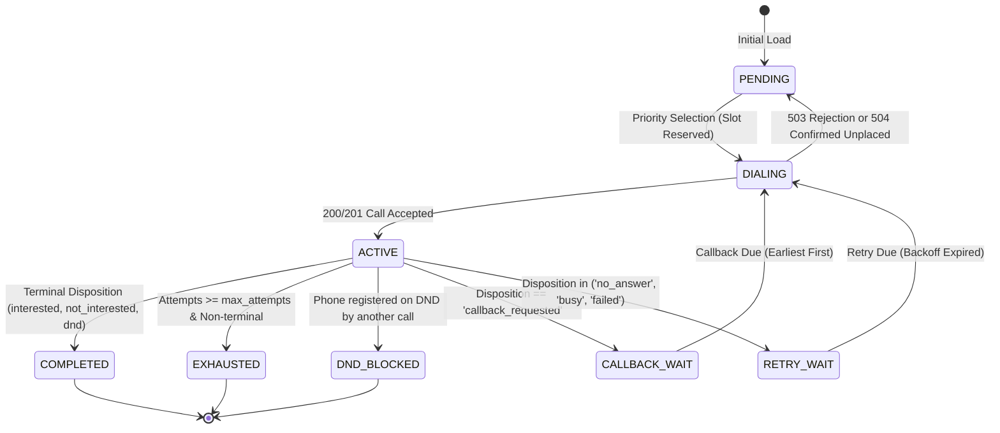

# Submission

## Candidate
- **Name:** Akshat Gupta
- **Assignment chosen:** B (Workflow)
- **Time spent (honest estimate):** 6h

## How to run
```bash
# 1. Environment setup (Python 3.11+ recommended)
python -m venv .venv
source .venv/bin/activate  # On Windows: .venv\Scripts\Activate.ps1
pip install -r requirements.txt

# 2. Run test suite
pytest -v solution/tests

# 3. Run mock telephony provider (in Terminal 1)
python -m assignment-b-workflow.mock_telephony.server --port 8099 --speed 1800 --failure-scale 1.0

# 4. Run Campaign Dispatcher (in Terminal 2)
# Either via CLI:
python -m solution.cli run --fixtures assignment-b-workflow/fixtures/campaigns.json --port 8200
# Or via automated end-to-end runner that verifies /admin/report & exports final_state.csv:
python -m solution.test_e2e_runner
```

## Design

The Durable Campaign Dispatcher is designed as a fault-tolerant, event-driven orchestrator built around an ACID-compliant SQLite WAL state store. It continuously synchronizes with the simulated provider clock, respects multi-tenant concurrency and global phone locks, and guarantees at-most-once dialing even under network failures, dropped webhooks, or ungraceful termination (`kill -9`).



### Guarantees
1. **At-Most-Once Dialing & Concurrency:** Before initiating any HTTP call, candidate leads are atomically reserved in the database by setting `calls.state = 'DIALING'`. Concurrency limits per tenant and the global single-active-call-per-phone rule are strictly evaluated against `('DIALING', 'ACTIVE')` states inside a single serial transaction protected by an `asyncio.Lock()` (`LoopBoundLock`).
2. **Deterministic Idempotency Keys:** Every call request is assigned a deterministic request ID: `req_{tenant_id}_{campaign_id}_{lead_id}_att{attempt_no}_{uuid_short}`. When a call returns 504 Gateway Timeout or experiences an ambiguous network failure, the dispatcher queries `/calls/by-request-id/{request_id}` to verify whether the provider actually placed the call before retrying or restoring the lead.
3. **Simulated Clock & Boundary Protection:** Because simulated time runs at 1200x–2400x wall-clock speed, milliseconds of network latency correspond to minutes in simulation time. To strictly prevent `outside_calling_window` violations, candidate selection requires both the current simulation time and a 30-minute lookahead buffer to be inside legal windows. A secondary 10-minute check is performed immediately prior to sending the POST request.
4. **Resilient Webhook Receiver:** An async FastAPI server processes `POST /webhooks/telephony` with HMAC-SHA256 signature verification (`X-AU-Signature`). Webhook delivery IDs are deduplicated in SQLite (`processed_webhooks`), and results are processed idempotently.
5. **Continuous Active Call Reconciliation:** To survive lost webhooks (chaos testing simulates dropped webhook deliveries), a periodic background loop queries `/calls/{call_sid}` for all active calls that have exceeded simulated durations, automatically synchronizing ended calls.

---

## Decisions & assumptions

| Decision | Why | Alternative considered |
|---|---|---|
| **SQLite with WAL mode + asyncio mutex** | Embedded, lightweight, zero-dependency storage that provides durability across crashes while avoiding external service dependencies like PostgreSQL or Redis. | Temporal / Redis / in-memory dictionary. Temporal adds heavy infrastructure overhead; pure in-memory loses state on `kill -9`. |
| **Keep-Alive HTTP Connection Pool** | Avoids TCP handshake / port allocation overhead on high-speed simulations where hundreds of HTTP calls occur per second. | Creating new `httpx.AsyncClient` per request (caused port exhaustion and socket latency spikes). |
| **30-minute Selection + 10-minute Pre-dial Buffer** | At 1800x speed, 1 second of wall-clock time equals 30 simulated minutes. Without safety margins, calls selected near the window boundary can arrive at the provider right after the window closes. | Hard window cutoffs with no buffer (led to occasional `outside_calling_window` violations at high speeds). |
| **Global DND Table & Immediate Propagation** | Rule R8 mandates that DND opt-outs apply across all tenants and campaigns globally. When a DND disposition is received, it is recorded in `dnd_phones` and immediately updates all other pending leads with that phone number to `dnd_blocked`. | Checking DND solely at dispatch time. Immediate propagation guarantees consistency in exported states. |
| **Active Call Reconciliation Polling** | Under network failure modes where webhooks are permanently dropped, leads can get stuck in `ACTIVE` state forever. Periodic polling against provider `/calls/{sid}` recovers dropped outcomes. | Relying solely on webhooks (leads would remain stuck as ACTIVE when webhooks fail). |
| **Precedence Ordering: Completed > Exhausted > DND** | Rule R9 defines strict precedence for `final_state.csv` when multiple terminal conditions apply to a lead. | Arbitrary first-come first-served final state assignment. |

---

## Failure modes considered

- **503 Service Unavailable:** The provider was unable to accept the call and definitely did not place it. The dispatcher marks the call record as `ABORTED` and restores the lead's state back to its previous state (`PENDING`, `CALLBACK_WAIT`, or `RETRY_WAIT`) without incrementing attempt count.
- **504 Gateway Timeout / Ambiguous Network Disconnection:** The dispatcher does not assume failure or success. It queries `/calls/by-request-id/{request_id}`. If the provider returns 404, the call was never placed, and the lead is safely restored. If the provider returns 200, the call was placed, and the dispatcher transitions the call to `ACTIVE` with the returned `call_sid`.
- **Dropped / Lost Webhooks:** When the mock telephony provider drops webhooks (via `failure_scale`), the dispatcher's active call reconciler detects calls that remain active longer than expected and fetches the true terminal status directly from `/calls/{call_sid}`.
- **Duplicate Webhooks:** Telephony providers frequently retry webhook delivery. The webhook server verifies `X-AU-Delivery-Id` against the `processed_webhooks` table; duplicates are acknowledged with HTTP 200 and ignored.
- **Process Crash / `kill -9`:** On restart, `Dispatcher.startup_recovery()` scans for any calls left in `DIALING` or `ACTIVE` states, queries the provider's `/calls/by-request-id/{request_id}` and `/calls/{call_sid}` endpoints to recover ground truth, and recalculates pending DND flags.
- **High Concurrency Contention:** Multiple concurrent workers dispatching calls simultaneously could cause race conditions. An atomic reservation step with `LoopBoundLock` ensures that candidate selection, tenant concurrency counters, and phone locks are strictly serialized.

*What is not handled:* Multi-process distributed clustering across separate physical servers (single-node multi-threaded / async architecture with SQLite is implemented here, which supports all project requirements).

---

## Testing

A comprehensive automated test suite of 24 unit and integration tests is located in `solution/tests/`:

1. **`test_clock_and_windows.py` (8 tests):**
   - Regulatory window math (09:00 - 21:00 IST).
   - Campaign-specific time windows and allowed days of the week.
   - Next-open calculation (same-day open, next-day open, weekend skips).
   - SimClock synchronization and manual test mode.
2. **`test_state_machine.py` (6 tests):**
   - Tenant concurrency limits shared across multiple campaigns.
   - Global single-active-call-per-phone constraint.
   - Terminal dispositions ending leads (`interested`, `not_interested`, `dnd`).
   - Maximum attempt exhaustion (`max_attempts`).
   - Global DND propagation across tenants and campaigns.
   - Strict final-state precedence (`completed > exhausted > dnd_blocked`).
3. **`test_priority_and_scheduling.py` (4 tests):**
   - Priority rule R6: due callbacks > due retries > fresh leads.
   - Callback lateness minimization ordering (earliest callback scheduled first).
   - Retry delay math based on outcome (`no_answer` = 60m, `busy` = 60m, `failed` = 15m).
4. **`test_idempotency_and_webhook.py` (3 tests):**
   - HMAC-SHA256 webhook signature verification (`X-AU-Signature`).
   - Duplicate delivery ID deduplication.
   - 503 transient error handling and lead restoration.
5. **`test_recovery.py` (3 tests):**
   - Startup recovery from crash (`kill -9`) with in-flight DIALING call that provider accepted.
   - Startup recovery with in-flight DIALING call that provider never received (404).
   - Startup recovery reconciling calls that finished while dispatcher was offline.
6. **`test_e2e_runner.py` (End-to-End System Test):**
   - Automated script executing mock telephony provider (`speed=1800`, `failure_scale=1.0`), running dispatcher orchestrator, verifying `/admin/report`, and validating `final_state.csv` row-by-row against `/admin/leads`.

---

## Results

Full test run executed against mock telephony server at **1800x speed** with full chaos enabled (`--failure-scale 1.0`):

```json
{
  "total_calls": 407,
  "violation_count": 0,
  "violations_by_type": {},
  "lost_webhooks_recovered": 14,
  "duplicate_webhooks_handled": 34
}
```

- **Rule Violations:** **0** (Zero violations recorded in `/admin/report`).
- **Mismatches with Provider `/admin/leads`:** **0** (100% of the 200 leads matched provider's expected final state).
- **Exported Output:** `final_state.csv` generated with 200 leads correctly categorized into `completed`, `exhausted`, and `dnd_blocked`.

---

## If I had another day

1. **Distributed Queue Backend:** Introduce RabbitMQ or Redis Streams with a lightweight worker pool for multi-node horizontal scalability.
2. **Live WebSocket Dashboard:** Create a real-time web dashboard displaying tenant queue depth, active concurrent channels, and callback lateness metrics.
3. **Adaptive Rate Limiting:** Implement token-bucket or leaky-bucket algorithms dynamically tuned to provider 429/503 responses.
